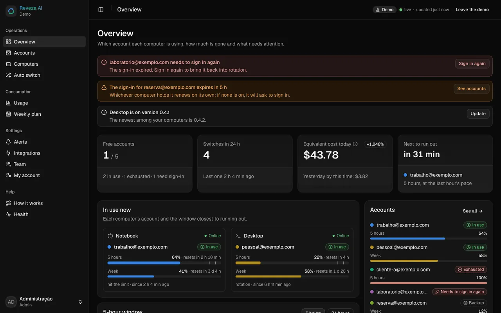
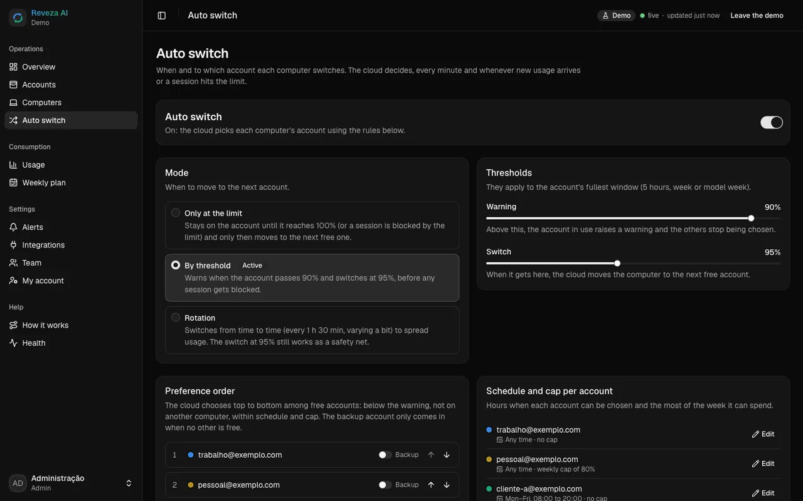
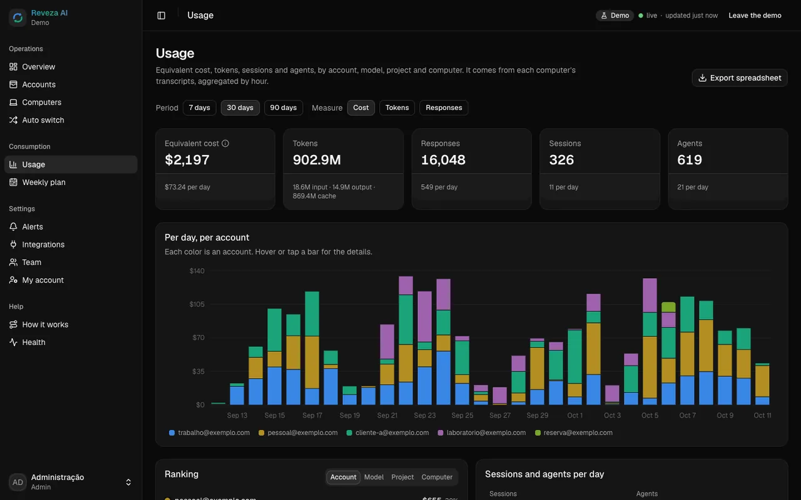
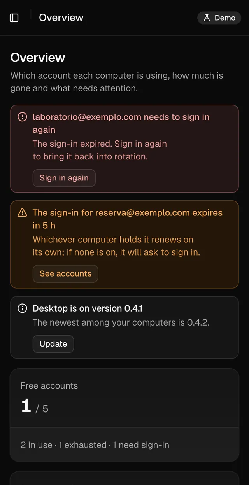
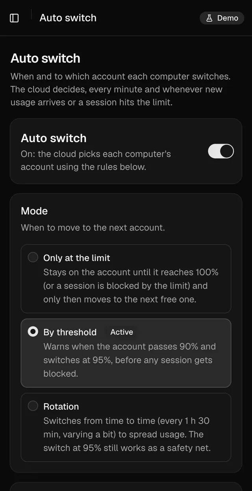
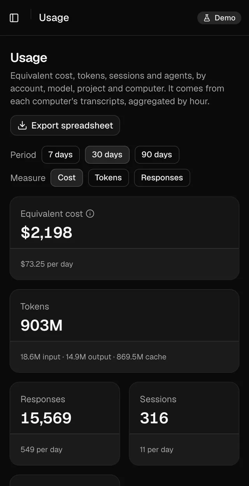
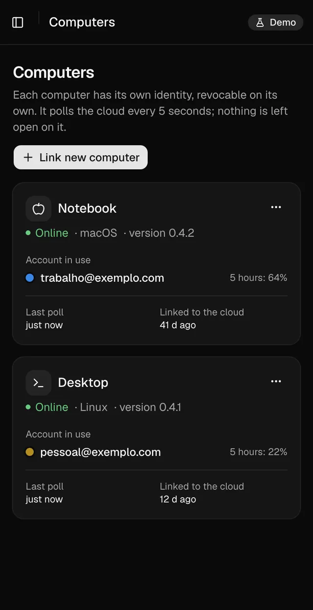
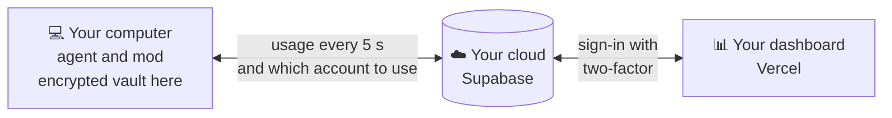

<div align="center">


<br/>

<a href="#-install"></a>
<a href="https://reveza.ia.br/en"></a>
<a href="CHANGELOG.md"></a>

<a href="README.md"></a>
<a href="#-support-the-project"></a>

<br/><br/>

**Reveza AI** switches your Claude Code account before the limit, so the work does not stop.<br/>
You connect your accounts once; it follows each one's usage, switches near the end and the session goes on on the new account.<br/>
Logins stay encrypted on your computer, and the dashboard lives in your own cloud.

</div>

<br/>

## 😮‍💨 The problem

If you use Claude Code all day, you know these three moments:

- **The limit hits at the worst time.** The 5-hour window runs out in the middle of a refactor, a deploy or an agent running overnight. Everything stops, and the context is left half done.
- **Switching accounts by hand breaks the flow.** Sign out, sign in to the other account, open the session again and explain everything once more. Several times a day.
- **Nobody knows which account has room left.** With several accounts and several people, nobody sees which one is running out, what each delivered or who is using it right now.

## 🔁 With Reveza

| Without Reveza | With Reveza AI |
|---|---|
| The session stops at 100% and you only find out then | Switches before the limit: warns at 90% and switches at 95% |
| Sign out, sign in to the other account and explain the context again | Open sessions keep going, already on the new account |
| The agent running overnight dies at the limit | The unattended session resumes on the next account by itself |
| Account passwords shared over chat | Each login encrypted on your computer; the cloud stores it without being able to read it |
| A spreadsheet to guess which account still has room | A dashboard with usage, cost and a forecast of when each account runs out |
| Everyone on the team sorting it out alone | A team with roles, alerts and the history of every switch |

Works with the accounts you already have. On every switch the computer plays a sound (you can turn it off).

<br/>

## 🖥️ The dashboard

<div align="center">

<br/>
<sub><b>Overview</b>: each computer's account, the 5-hour and weekly windows, and what needs attention.</sub>
<br/><br/>


<br/>
<sub><b>Automatic switching</b>: only at the limit, by threshold or rotating, with order, reserve and schedule. <b>Usage</b>: tokens and equivalent cost by day, account, model and project.</sub>
<br/><br/>




<br/>
<sub><b>On the phone</b>: the dashboard installs on the home screen. Screenshots from demo mode, with example accounts.</sub>
</div>

<br/>

## ⚙️ How it works



1. **Connect your accounts.** The official sign-in for each account, once, on your computer. Reveza never asks for an account password.
2. **It follows the usage.** The agent reads how much of the 5-hour window and of the week each account has used; the cloud picks the next one by the rule you set.
3. **Switches before the limit.** Near the end, the computer switches the account and the session continues where it stopped. If you want, an alert tells you what happened.

The computer only calls the cloud: no open port, no tunnel. Without internet, it keeps the current account and does not switch.

<br/>

## 📥 Install

```bash
npx github:dantaspaulo/reveza --idioma en
```

It asks and sets everything up: checks the computer, installs the agent and the mod, creates your cloud on Supabase,
deploys the dashboard on Vercel (with your own domain, if you want), connects the accounts, sets up alerts and runs a
final check. The Supabase and Vercel tokens are **not stored** anywhere.

| You need | |
|---|---|
| 🟢 **Node 20.19 or newer** | on macOS, Windows or Linux, including a headless VPS |
| 🪟 **On Windows** | `npx github:` needs [Git](https://git-scm.com/download/win); without it, use the release package: `npx https://github.com/dantaspaulo/reveza/archive/refs/tags/v0.1.2.tar.gz` |
| 🧡 **Claude Code** | installed on each computer that will rotate accounts |
| ☁️ **Supabase and Vercel** | free accounts are enough; without them, use `--sem-nuvem` |
| 🌐 **A domain** | optional, with a step-by-step guide on Cloudflare |

<details>
<summary><b>Every installer option</b></summary>

<br/>

| Option | What for |
|---|---|
| `--ligar` | joins one more computer to an existing installation: asks only for the dashboard's link code |
| `--atualizar` | updates agent, mod, database and dashboard; accounts, usage and settings stay |
| `--sem-nuvem` | this computer only: agent, mod and accounts, no online dashboard |
| `--demo` | the dashboard with example data, no cloud, no account touched |
| `--sombra` | next to another account manager, switching nothing (port 7789) |
| `--importar <folder>` | copies accounts and usage from another manager; the source does not change |
| `--doctor` | checks the installation: agent, service, cloud, dashboard and security headers |
| `--desinstalar` | removes the service and the mod; logins, usage, vault key and the computer in the cloud stay (to remove it for good, revoke the computer in the dashboard) |
| `--idioma en` | questions in English |
| `--sim` | no questions (reads `SUPABASE_ACCESS_TOKEN`, `VERCEL_TOKEN`, `REVEZA_ADMIN_EMAIL`, `REVEZA_ADMIN_SENHA`, `REVEZA_SUPABASE_REF` and `REVEZA_DOMINIO` from the environment) |

</details>

<br/>

## ➕ A new computer, with one code

1. In the dashboard: **Computers → Link new computer → Generate the link code**.
2. The computer that already uses Reveza plays a sound and opens a window. Type in it the 4-character code the dashboard shows and click **Release**.
3. On the new computer, run `npx github:dantaspaulo/reveza --ligar` and paste the code the dashboard showed. Done: it joins on its own, accounts included.

The code is valid for 10 minutes, once. The cloud alone cannot release the vault key: whoever releases types, on the
computer's screen, the code that only your dashboard shows.

<br/>

## 🧑‍💻 Day to day

```bash
reveza status            # account in use, usage per account, next switch
reveza trocar a@example.com
reveza uso --csv         # usage log as a spreadsheet
reveza som desligar      # turns off the switch sound (som ligar, som testar)
reveza doctor            # diagnostics
```

Inside sessions, **`/reveza`** shows the accounts, and the status line shows the account in use and the 5-hour window.

<details>
<summary><b>🔌 API and webhooks</b></summary>

<br/>

Create a key under **Integrations** in the dashboard, with the scopes you need.

```bash
curl -H "Authorization: Bearer rvz_..." https://<project>.supabase.co/functions/v1/api/estado
curl -H "Authorization: Bearer rvz_..." "https://<project>.supabase.co/functions/v1/api/uso?dias=7"
curl -X POST -H "Authorization: Bearer rvz_..." -d '{"computador":"<id>","conta":"<id>"}' https://<project>.supabase.co/functions/v1/api/trocar
```

Webhooks carry `X-Reveza-Assinatura: sha256=<HMAC-SHA256 of the body with your secret>`. Check it before trusting:

```js
const expected = "sha256=" + crypto.createHmac("sha256", secret).update(rawBody).digest("hex");
```

</details>

<br/>

## 🔐 Security

- **The cloud stores, but cannot read.** Each login is encrypted on the computer (AES-256-GCM). The vault key lives only in the system keychain; Supabase receives ciphertext and Vercel not even that.
- **Least privilege.** No server key outside Supabase. Every table has row-level security, every change goes through a function that checks the role and writes the audit log. Each computer has its own identity, revocable on its own.
- **Dashboard sign-in** by invitation only, strong password, two-factor for admins (and the option to require it from everyone).
- **Published dashboard** with a strict CSP, HSTS and no secret in the browser.
- **Audited** with [Cloudflare's security audit skill](https://github.com/cloudflare/security-audit-skill): the confirmed findings were fixed, and the repository guard refuses secrets and personal data on every commit.

The whole architecture is in [docs/ARQUITETURA.md](docs/ARQUITETURA.md) (Portuguese).

<br/>

## 🤝 Contribute

Found a bug or have an idea? [Open an issue](https://github.com/dantaspaulo/reveza/issues). Want to change the code?
Pull requests are welcome, translations included. If Reveza saved you from a stop at the limit, leave a ⭐.

```bash
git config core.hooksPath .githooks         # the guard: refuses secrets, personal data and React Bits components
cd agente && npm ci && npm test             # agent: switching, vault, ownership, fake cloud
cd nuvem && npm ci && npm test              # database (PGlite with the migrations) and functions
npm ci && npm test                          # installer and guards
cd painel && npm ci && npm run react-bits && npm run dev   # dashboard at http://localhost:5173/?demo=1
npm run auditoria                           # npm audit on every lockfile
node scripts/versao.mjs lancar X.Y.Z        # new version: write the CHANGELOG first; bumps everything, tag and release
```

<br/>

## 💛 Support the project

Reveza is free and open source. If it saved you from stops at the limit, a contribution helps keep up development,
security reviews and new versions.

<div align="center">

<a href="https://www.asaas.com/000/c/fymw4xl2f5b3n05b"></a>
<a href="https://wa.me/?text=Reveza%20AI%20switches%20your%20Claude%20Code%20account%20before%20the%20limit%20and%20the%20session%20goes%20on.%20Free%20and%20open%20source%3A%20https%3A//reveza.ia.br/en"></a>

</div>

- **R$ 100 through Asaas**, by Pix, card or boleto (Brazilian reais): [support the project](https://www.asaas.com/000/c/fymw4xl2f5b3n05b).
- **Larger amounts, straight by Pix**, any amount you like. Key (phone): `84988942848`.
- **Know someone who keeps hitting the limit?** [Send them Reveza on WhatsApp](https://wa.me/?text=Reveza%20AI%20switches%20your%20Claude%20Code%20account%20before%20the%20limit%20and%20the%20session%20goes%20on.%20Free%20and%20open%20source%3A%20https%3A//reveza.ia.br/en).

<sub>Contributions go to PSD Software, which maintains the project. Supporting is optional: Reveza stays free and open for everyone.</sub>

<br/>

## 💰 Costs and licenses

- **Supabase and Vercel:** the free plans are enough to start. Your Claude accounts stay yours, as they are.
- **React Bits:** the dashboard's free components are MIT + Commons Clause and are not in the repository; the installer downloads them on your machine and checks each one.
- **Reveza AI:** MIT. Use it, adapt it and share it.

> Each person is responsible for the use of their own accounts and for the terms of the AI service they use. Reveza AI
> is an independent project, not affiliated with Anthropic. Claude and Claude Code are trademarks of Anthropic.

<br/>

<!-- quem-fez -->
<div align="center">

## 👋 Who made it

<a href="https://github.com/dantaspaulo">
<picture>
  <source media="(max-width: 700px)" srcset="https://raw.githubusercontent.com/dantaspaulo/dantaspaulo/main/assets/papeis-celular.svg" />
  
</picture>
</a>

**Paulo Sérgio Dantas** builds businesses with AI.<br/>
<sub>Reveza was born for my own Claude Code accounts. I also opened <a href="https://github.com/dantaspaulo/claquete">Claquete.ai</a>, the video studio Claude operates.</sub>

<br/>

<a href="https://github.com/dantaspaulo"></a>
<a href="https://paulosdantas.adv.br"></a>
<a href="https://www.linkedin.com/in/paulosdantas/"></a>
<a href="mailto:contato@paulosdantas.adv.br"></a>

<br/><br/>

<sub>Using Reveza with your team? Tell me.</sub>


</div>
<!-- /quem-fez -->
