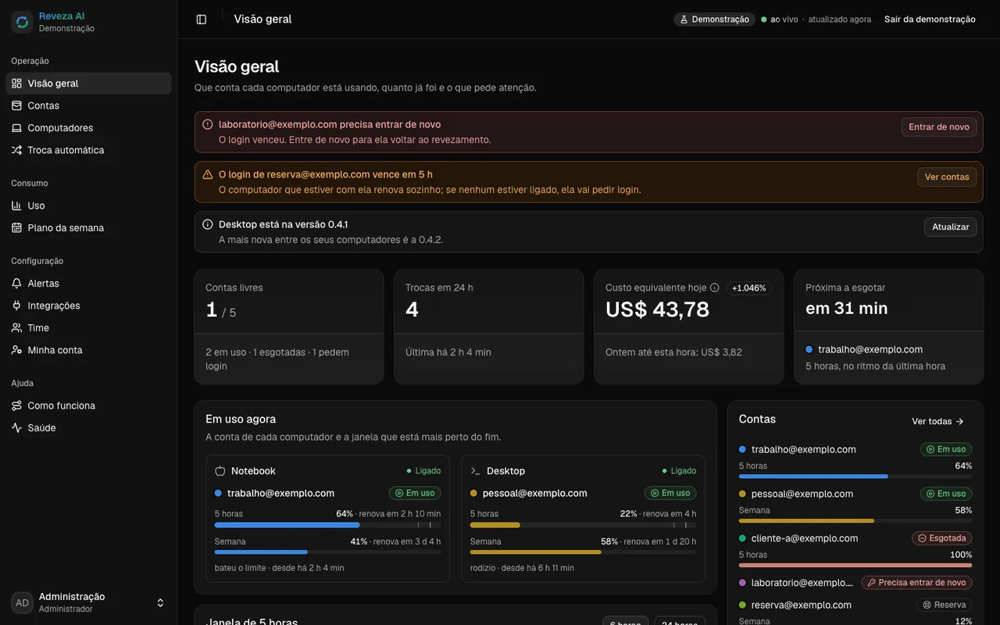
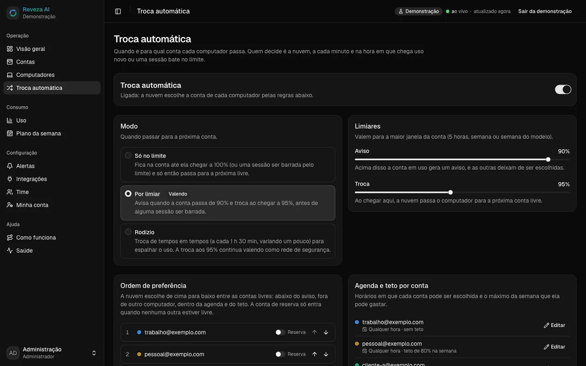
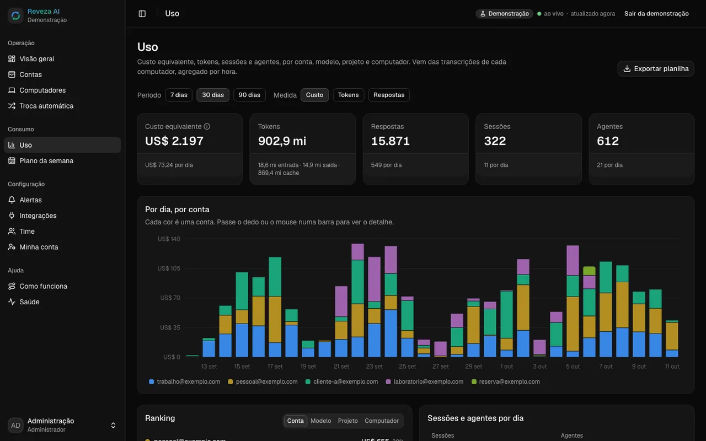
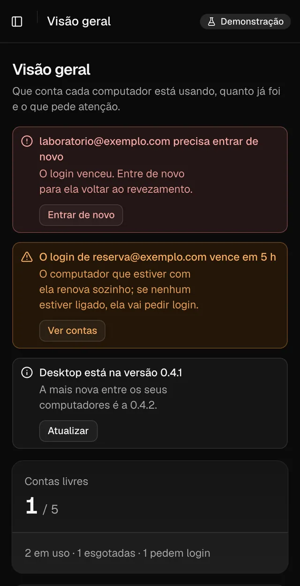
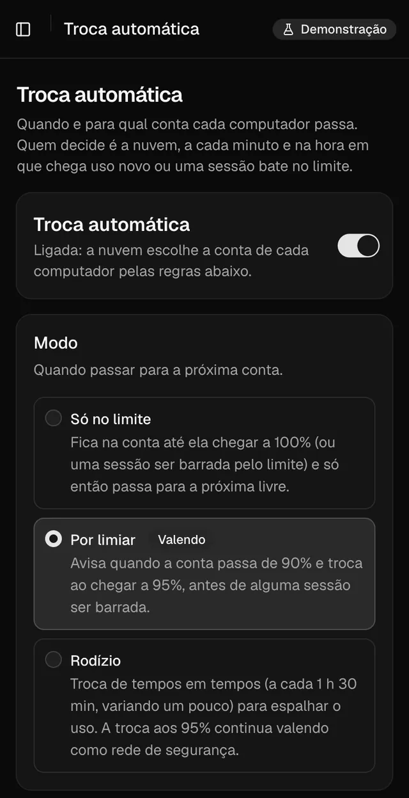
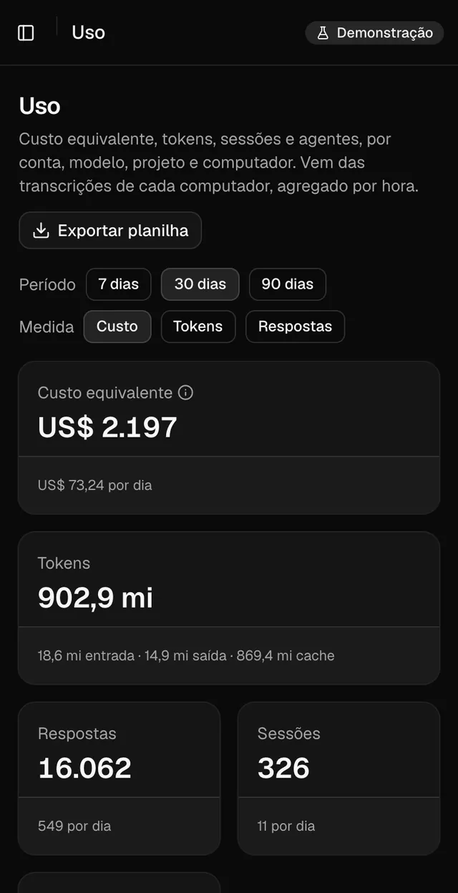
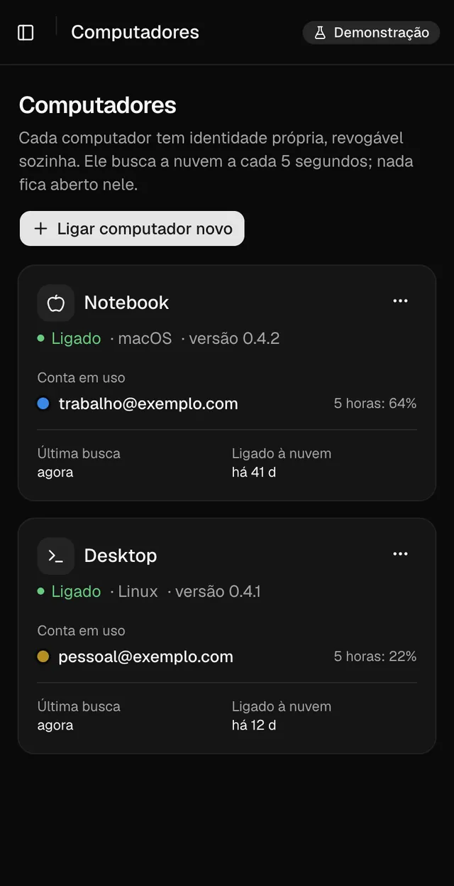
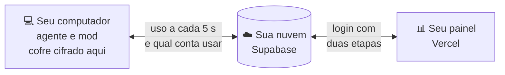

<div align="center">


<br/>

<a href="#-instalar"></a>
<a href="https://reveza.ia.br"></a>
<a href="CHANGELOG.md"></a>

<a href="README.en.md"></a>
<a href="#-apoie-o-projeto"></a>

<br/><br/>

**Reveza AI** troca a conta do Claude Code antes do limite, para o trabalho não parar.<br/>
Você conecta as suas contas uma vez; ele acompanha o uso de cada uma, troca perto do fim e a sessão segue na conta nova.<br/>
Os logins ficam cifrados no seu computador, e o painel mora na sua própria nuvem.

🌐 **Site do projeto: [https://reveza.ia.br](https://reveza.ia.br)**

</div>

<br/>

## 😮‍💨 O problema

Quem usa o Claude Code o dia todo conhece estes três momentos:

- **O limite chega na pior hora.** A janela de 5 horas acaba no meio de uma refatoração, de um deploy ou de um agente rodando de madrugada. Tudo para, e o contexto fica pela metade.
- **Trocar de conta na mão quebra o ritmo.** Sair, entrar na outra conta, abrir a sessão de novo e explicar tudo outra vez. Várias vezes por dia.
- **Ninguém sabe qual conta ainda tem fôlego.** Com várias contas e várias pessoas, ninguém vê qual está no fim, quanto cada uma rendeu nem quem está usando agora.

## 🔁 Com o Reveza

| Sem o Reveza | Com o Reveza AI |
|---|---|
| A sessão para em 100% e você descobre na hora | Troca antes do limite: avisa em 90% e troca em 95% |
| Sair, entrar na outra conta e explicar o contexto de novo | As sessões abertas seguem, já na conta nova |
| O agente que rodava de madrugada morre no limite | A sessão sem ninguém retoma sozinha na conta seguinte |
| Senha de conta passada por mensagem | Cada login cifrado no seu computador; a nuvem guarda sem conseguir ler |
| Planilha para adivinhar qual conta ainda tem saldo | Painel com uso, custo e previsão de esgotar de cada conta |
| Cada pessoa do time resolvendo no seu canto | Time com papéis, alertas e o histórico de cada troca |

Funciona com as contas que você já tem. A cada troca, o computador faz um som (dá para desligar).

<br/>

## 🖥️ O painel

<div align="center">

<br/>
<sub><b>Visão geral</b>: a conta de cada computador, a janela de 5 horas e da semana, e o que pede atenção.</sub>
<br/><br/>


<br/>
<sub><b>Troca automática</b>: só no limite, por limiar ou em rodízio, com ordem, reserva e agenda. <b>Uso</b>: tokens e custo equivalente por dia, conta, modelo e projeto.</sub>
<br/><br/>




<br/>
<sub><b>No celular</b>: o painel instala na tela inicial. Imagens do modo demonstração, com contas de exemplo.</sub>
</div>

<br/>

## ⚙️ Como funciona



1. **Conecte suas contas.** Login oficial de cada conta, uma vez, no seu computador. O Reveza não pede senha de conta.
2. **Ele acompanha o uso.** O agente lê quanto cada conta já gastou da janela de 5 horas e da semana; a nuvem escolhe a próxima pela regra que você definir.
3. **Troca antes do limite.** Perto do fim, o computador troca a conta e a sessão continua de onde parou. Se quiser, um alerta conta o que aconteceu.

O computador só chama a nuvem: nenhuma porta aberta, nenhum túnel. Sem internet, ele mantém a conta atual e não troca.

<br/>

## 📥 Instalar

```bash
npx github:dantaspaulo/reveza
```

Ele pergunta e monta tudo: confere o computador, instala o agente e o mod, cria a sua nuvem no Supabase, publica o
painel na Vercel (com domínio próprio, se quiser), conecta as contas, configura os alertas e faz uma prova final.
Os tokens do Supabase e da Vercel **não ficam guardados** em lugar nenhum.

| Precisa de | |
|---|---|
| 🟢 **Node 20.19 ou mais novo** | no macOS, no Windows ou no Linux, inclusive numa VPS sem tela |
| 🪟 **No Windows** | o `npx github:` precisa do [Git](https://git-scm.com/download/win); sem ele, use o pacote da versão: `npx https://github.com/dantaspaulo/reveza/archive/refs/tags/v0.1.4.tar.gz` |
| 🧡 **Claude Code** | instalado em cada computador que vai revezar contas |
| ☁️ **Supabase e Vercel** | contas grátis bastam; sem elas, use `--sem-nuvem` |
| 🌐 **Domínio** | opcional, com o passo a passo da Cloudflare |

<details>
<summary><b>Todas as opções do instalador</b></summary>

<br/>

| Opção | Para quê |
|---|---|
| `--ligar` | liga mais um computador a uma instalação que já existe: pede só o código de ligação do painel |
| `--atualizar` | atualiza agente, mod, banco e painel; contas, uso e configuração ficam |
| `--sem-nuvem` | só neste computador: agente, mod e contas, sem painel online |
| `--demo` | o painel com dados de exemplo, sem nuvem e sem mexer em conta nenhuma |
| `--sombra` | ao lado de outro gestor de contas, sem trocar nada (porta 7789) |
| `--importar <pasta>` | copia contas e uso de outro gestor; a origem não muda |
| `--doctor` | confere a instalação: agente, serviço, nuvem, painel e cabeçalhos de segurança |
| `--desinstalar` | tira o serviço e o mod; logins, uso, chave do cofre e o computador na nuvem ficam (para tirar de vez, revogue o computador no painel) |
| `--idioma en` | perguntas em inglês |
| `--sim` | sem perguntas (lê `SUPABASE_ACCESS_TOKEN`, `VERCEL_TOKEN`, `REVEZA_ADMIN_EMAIL`, `REVEZA_ADMIN_SENHA`, `REVEZA_SUPABASE_REF` e `REVEZA_DOMINIO` do ambiente) |

</details>

<br/>

## ➕ Computador novo, com um código só

1. No painel: **Computadores → Ligar computador novo → Gerar o código de ligação**.
2. O computador que já usa o Reveza toca um som e abre uma janela. Digite nela o código de 6 caracteres que o painel mostra e clique em **Liberar**.
3. No computador novo, rode `npx github:dantaspaulo/reveza --ligar` e cole o código que o painel mostrou. Pronto: ele entra sozinho, já com as contas.

O código vale 10 minutos e uma vez só. A nuvem sozinha não consegue liberar a chave do cofre: quem libera digita, na
tela do computador, o código que só o seu painel mostra.

<br/>

## 🧑‍💻 No dia a dia

```bash
reveza status            # conta em uso, uso de cada conta, próxima troca
reveza trocar a@exemplo.com
reveza uso --csv         # registro de uso em planilha
reveza som desligar      # tira o som da troca (som ligar, som testar)
reveza doctor            # diagnóstico
```

Dentro das sessões, **`/reveza`** mostra as contas, e a linha de status mostra a conta em uso e a janela de 5 horas.

<details>
<summary><b>🔌 API e webhooks</b></summary>

<br/>

Crie uma chave em **Integrações**, no painel, com os escopos que precisar.

```bash
curl -H "Authorization: Bearer rvz_..." https://<projeto>.supabase.co/functions/v1/api/estado
curl -H "Authorization: Bearer rvz_..." "https://<projeto>.supabase.co/functions/v1/api/uso?dias=7"
curl -X POST -H "Authorization: Bearer rvz_..." -d '{"computador":"<id>","conta":"<id>"}' https://<projeto>.supabase.co/functions/v1/api/trocar
```

Os webhooks levam `X-Reveza-Assinatura: sha256=<HMAC-SHA256 do corpo com o seu segredo>`. Confira antes de confiar:

```js
const esperado = "sha256=" + crypto.createHmac("sha256", segredo).update(corpoBruto).digest("hex");
```

</details>

<br/>

## 🔐 Segurança

- **A nuvem guarda, mas não lê.** Cada login é cifrado no computador (AES-256-GCM). A chave do cofre mora só no chaveiro do sistema; o Supabase recebe texto cifrado e a Vercel nem isso.
- **Menor privilégio.** Nenhuma chave de servidor fora do Supabase. Toda tabela tem segurança de linha, toda mudança passa por uma função que confere o papel e grava a auditoria. Cada computador tem identidade própria, revogável sozinha.
- **Login do painel** só por convite, senha forte, duas etapas para quem administra (e a opção de exigir de todos).
- **Painel publicado** com CSP restrita, HSTS e nenhum segredo no navegador.
- **Auditado** com a [skill de auditoria de segurança da Cloudflare](https://github.com/cloudflare/security-audit-skill): os achados foram corrigidos, e a trava do repositório recusa segredo e dado pessoal em todo commit.

A arquitetura inteira está em [docs/ARQUITETURA.md](docs/ARQUITETURA.md).

<br/>

## 🤝 Contribuir

Achou um bug ou tem uma ideia? [Abra uma issue](https://github.com/dantaspaulo/reveza/issues). Quer mexer no código?
Pull requests são bem-vindos, inclusive traduções. Se o Reveza te poupou de uma parada no limite, deixe uma ⭐.

```bash
git config core.hooksPath .githooks         # a trava: recusa segredo, dado pessoal e componente do React Bits
cd agente && npm ci && npm test             # agente: troca, cofre, posse, nuvem falsa
cd nuvem && npm ci && npm test              # banco (PGlite com as migrações) e funções
npm ci && npm test                          # instalador e travas
cd painel && npm ci && npm run react-bits && npm run dev   # painel em http://localhost:5173/?demo=1
npm run auditoria                           # npm audit em todas as travas
node scripts/versao.mjs lancar X.Y.Z        # versão nova: escreva a CHANGELOG antes; sobe tudo, tag e release
```

<br/>

## 💛 Apoie o projeto

O Reveza é grátis e de código aberto. Se ele te poupou de paradas no limite, uma contribuição ajuda a manter o
desenvolvimento, a revisão de segurança e as versões novas.

<div align="center">

<a href="https://www.asaas.com/000/c/fymw4xl2f5b3n05b"></a>
<a href="https://wa.me/?text=O%20Reveza%20AI%20troca%20a%20conta%20do%20Claude%20Code%20antes%20do%20limite%20e%20a%20sess%C3%A3o%20continua.%20Gr%C3%A1tis%20e%20de%20c%C3%B3digo%20aberto%3A%20https%3A//reveza.ia.br"></a>

</div>

- **R$ 100 pelo Asaas**, no Pix, no cartão ou no boleto: [apoiar o projeto](https://www.asaas.com/000/c/fymw4xl2f5b3n05b).
- **Valores maiores, direto no Pix**, com o valor que quiser. Chave (celular): `84988942848`.
- **Conhece alguém que vive batendo no limite?** [Mande o Reveza no WhatsApp](https://wa.me/?text=O%20Reveza%20AI%20troca%20a%20conta%20do%20Claude%20Code%20antes%20do%20limite%20e%20a%20sess%C3%A3o%20continua.%20Gr%C3%A1tis%20e%20de%20c%C3%B3digo%20aberto%3A%20https%3A//reveza.ia.br).

<sub>As contribuições vão para a PSD Software, que mantém o projeto. Apoiar é opcional: o Reveza segue grátis e aberto para todo mundo.</sub>

<br/>

## 💰 Custos e licenças

- **Supabase e Vercel:** os planos grátis bastam para começar. As contas do Claude continuam suas, do jeito que já são.
- **React Bits:** os componentes grátis do painel são MIT + Commons Clause e não vêm no repositório; o instalador baixa na sua máquina e confere cada um.
- **Reveza AI:** MIT. Use, adapte e compartilhe.

> Cada pessoa responde pelo uso das próprias contas e pelos termos do serviço de IA que usa. O Reveza AI é um projeto
> independente, sem vínculo com a Anthropic. Claude e Claude Code são marcas da Anthropic.

<br/>

<!-- quem-fez -->
<div align="center">

## 👋 Quem fez

<a href="https://github.com/dantaspaulo">
<picture>
  <source media="(max-width: 700px)" srcset="https://raw.githubusercontent.com/dantaspaulo/dantaspaulo/main/assets/papeis-celular.svg" />
  
</picture>
</a>

**Paulo Sérgio Dantas** constrói negócios com IA.<br/>
<sub>O Reveza nasceu para as minhas próprias contas do Claude Code. Também abri o <a href="https://github.com/dantaspaulo/claquete">Claquete.ai</a>, o estúdio de vídeo que o Claude opera.</sub>

<br/>

<a href="https://github.com/dantaspaulo"></a>
<a href="https://paulosdantas.adv.br"></a>
<a href="https://www.linkedin.com/in/paulosdantas/"></a>
<a href="mailto:contato@paulosdantas.adv.br"></a>

<br/><br/>

<sub>Usa o Reveza no seu time? Me conta.</sub>


</div>
<!-- /quem-fez -->
